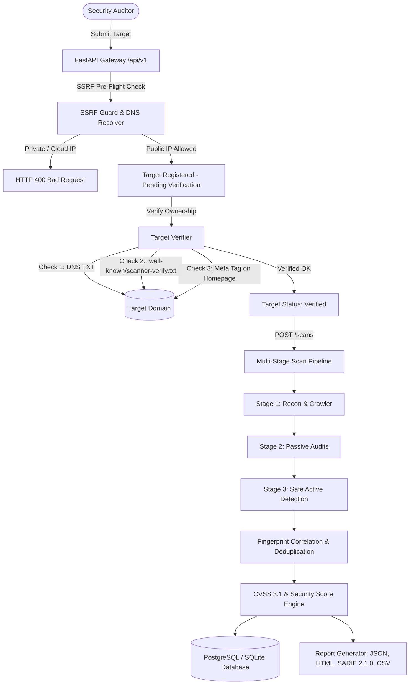

# VulnGuard Enterprise Web Vulnerability Scanning Platform — Backend

A comprehensive, production-ready, automated web vulnerability scanning backend engineered with Python 3.11+, FastAPI, Pydantic v2, and SQLAlchemy 2.



## 🚀 Key Features

1. **Target Ownership Verification (Section 3):**
   - DNS TXT record (`_scanner-verify.<domain> = <token>`)
   - Well-known file (`https://<domain>/.well-known/scanner-verify.txt`)
   - Homepage meta tag (`<meta name="scanner-verify" content="<token>">`)
   - Unverified targets are strictly blocked with **HTTP 403 Forbidden**.

2. **SSRF Guard & Rate Limiting (Section 2):**
   - Hard blocks RFC 1918, RFC 6598, loopback, IPv6 link-local, and cloud metadata (`169.254.169.254`).
   - Re-resolves DNS at request time to prevent DNS rebinding attacks.
   - Outbound requests rate-limited to 10 req/s (hard cap 50 req/s).

3. **Detection-Only Security Auditing (Section 2 & 6):**
   - Harmless canaries and error-signature probes only.
   - No destructive mutating actions, no data extraction, no credential brute-forcing.

4. **17+ Native Security & Vulnerability Modules (Section 9):**
   - `soft404.py`: Baseline random-path fingerprinting
   - `security_headers.py`: HSTS, CSP, XFO, XCTO, grading A-F
   - `cookies.py`: HttpOnly, Secure, SameSite, prefixes (__Host-, __Secure-)
   - `open_redirect.py`: Location header validation with benign marker domain
   - `reflected_xss.py`: Alphanumeric canary `<"'>` probe context analysis
   - `sqli_detect.py`: DBMS syntax signatures and boolean differential checks
   - `secrets_scan.py`: Regex + Shannon entropy detection with automatic redaction
   - `js_analysis.py`: DOM XSS sink inspection and API endpoint discovery
   - `subdomain_takeover.py`: CNAME fingerprinting
   - `graphql_api.py`: Introspection check and Swagger discovery
   - `http_methods.py`: OPTIONS / TRACE validation only
   - `crawler.py`: Async same-scope crawler with form extraction

5. **Multi-Format Export & CI/CD Integration (Section 12):**
   - Executive HTML Report with dark cybersecurity theme
   - SARIF 2.1.0 standard (OASIS standard for GitHub & GitLab Code Scanning)
   - JSON structured data
   - CSV spreadsheet format

## 💻 Quickstart

### Local Run:
```powershell
cd "g:\elastic Search\web vuln\backend"
python -m uvicorn app.main:app --host 0.0.0.0 --port 8000 --reload
```
Interactive Swagger API documentation will be available at: **http://localhost:8000/docs**

### Run Complete Test Suite:
```powershell
python -m pytest tests -v
```

### Docker Compose:
```bash
docker-compose up --build
```

